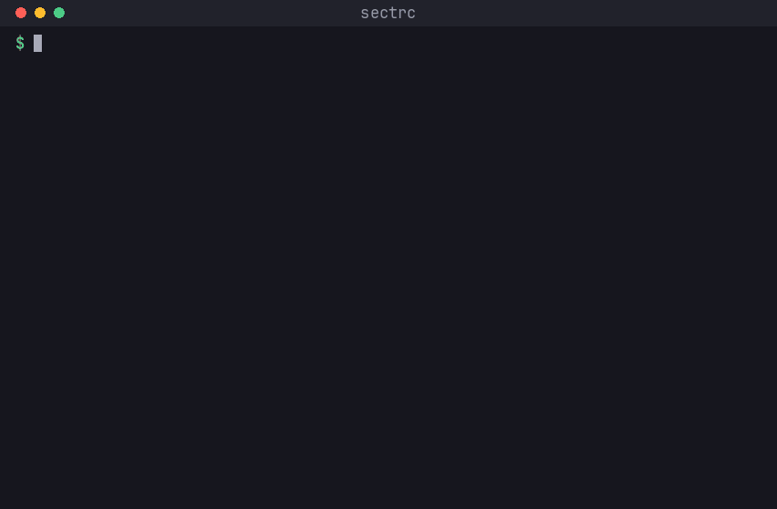
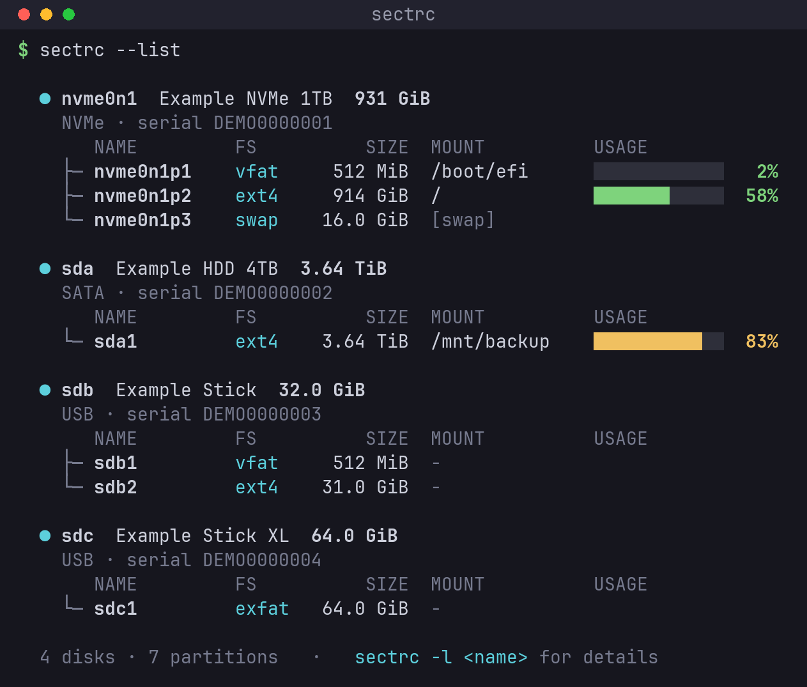
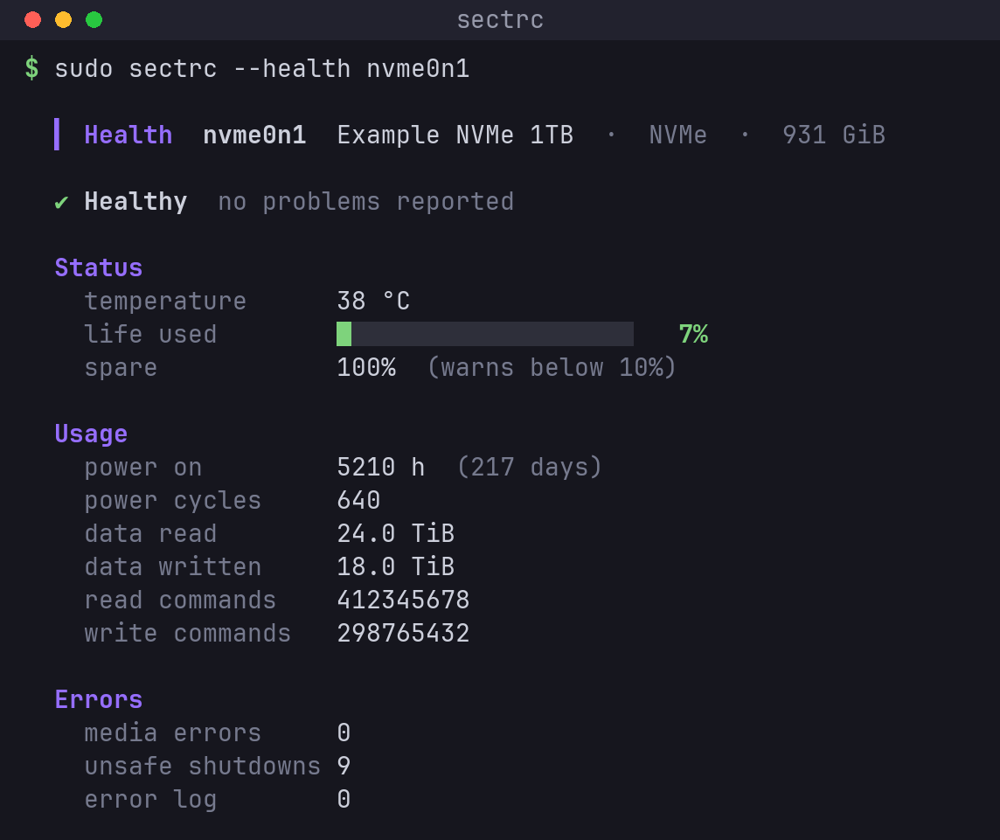
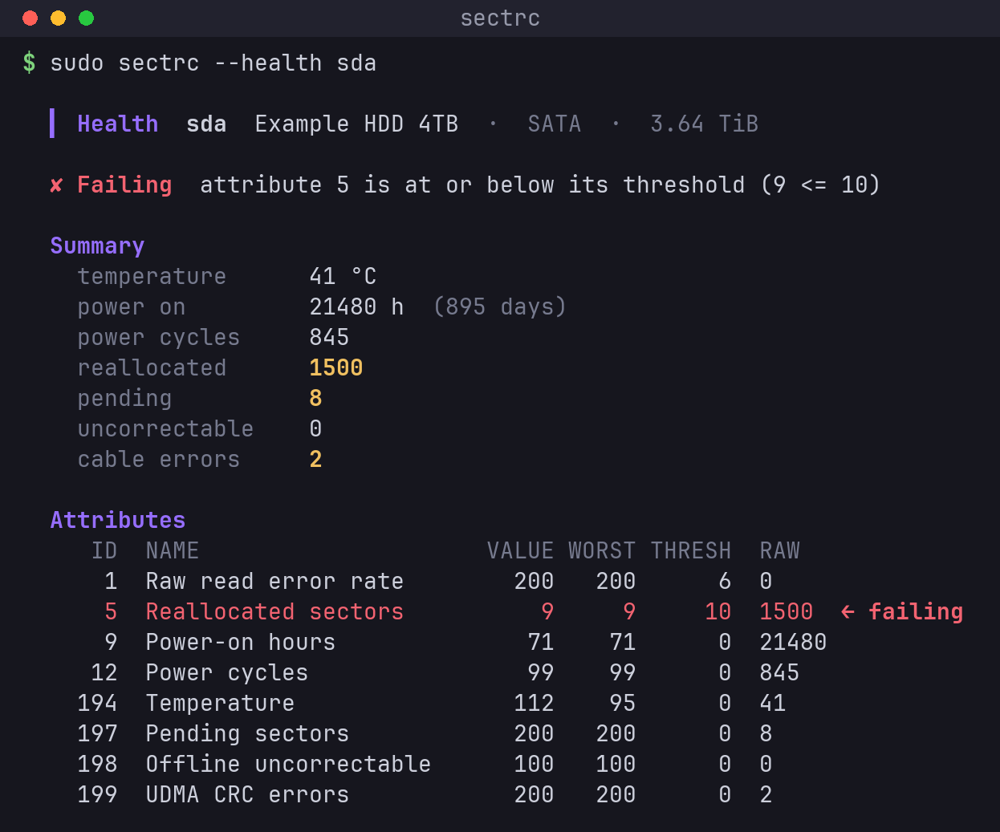
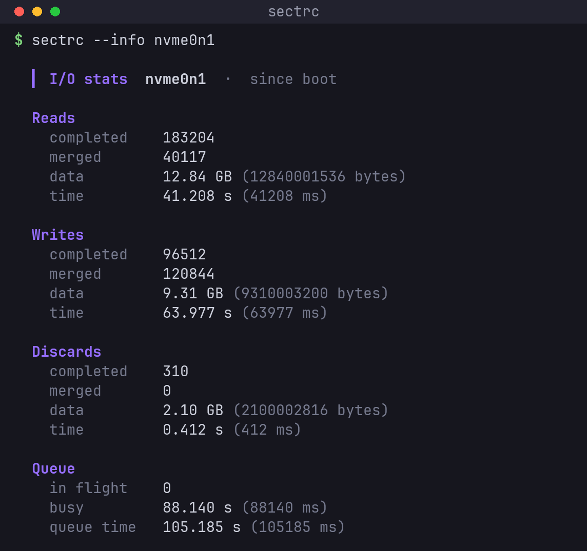

# SectrC

[](https://github.com/Dogwalker-kryt/SectrC/actions/workflows/build-and-release.yml)
[](https://github.com/Dogwalker-kryt/SectrC/releases/latest)
[](LICENSE)

**SectrC** is a small, fast Linux command-line tool for inspecting and managing disks and partitions, written in plain C.
It is a lightweight rewrite of [Sectr-ctl](https://github.com/Dogwalker-kryt/Sectr-ctl) that focuses on the terminal: no GUI and no TUI.

<p align="center">
  
</p>

> [!WARNING]
> SectrC is in **early development**. `--overwrite` and `--clone` **permanently destroy all data** on the target, and they are new and not widely tested.
> Both refuse mounted devices and ask before they start, but always check the device names and keep backups.

---

## Features

| Feature | Command | Status |
|---|---|---|
| List disks and partitions (model, vendor, bus, serial, size, filesystem, UUID, label, mountpoint) | `sectrc --list` | ✅ |
| Filter the list to one disk or partition | `sectrc --list sda` | ✅ |
| SHA-256 fingerprint of a drive's metadata | `sectrc --fingerprint nvme0n1` | ✅ |
| Built-in log viewer and log cleaner | `sectrc --view-logs`, `sectrc --clear-logs` | ✅ |
| I/O statistics of a disk or partition since boot | `sectrc --info sda` | ✅ |
| SMART health of SATA and NVMe disks, with a verdict | `sudo sectrc --health nvme0n1` | ✅ |
| Mount and unmount a partition | `sudo sectrc --mount sdb1:/mnt/usb`, `sudo sectrc --umount /mnt/usb` | ✅ |
| Erase a disk or partition (secure discard, discard or zero fill) | `sudo sectrc --overwrite sdb` | ✅ |
| Clone a disk or partition onto another one | `sudo sectrc --clone sdb:sdc` | ✅ |
| More operations from Sectr-ctl (formatting, encryption, …) | — | 🚧 planned |

## Screenshots

All drives, serial numbers and values in these pictures are made up. Regenerate them with `scripts/screenshots/generate.sh`.

**`sectrc --list`**: every disk and partition with usage bars



**`sectrc --health`**: SMART health of NVMe and SATA disks



<details>
<summary>More: a failing SATA disk and I/O statistics</summary>





</details>

## Quick start

### Install with the setup script (recommended)

```sh
git clone https://github.com/Dogwalker-kryt/SectrC.git
cd SectrC
./setup.sh
```

The script:

1. detects your distro and installs the build dependencies (apt, dnf, pacman or zypper; it asks for your `sudo` password)
2. compiles and links SectrC
3. installs the binary as **`~/.local/bin/sectr`** (the examples below use `sectrc`, the name of the release binary)
4. creates the log folder **`~/.local/state/sectrc/`**

| Option | What it does |
|---|---|
| `./setup.sh --skip-deps` | Build and install only, without touching system packages |
| `./setup.sh --uninstall` | Remove `~/.local/bin/sectr`, keep the logs |
| `./setup.sh --purge` | Remove the binary **and** the logs |

If `~/.local/bin` is not in your `PATH`, the script tells you the line to add to your shell config.

### Download a release

Prebuilt Linux x86-64 binaries are attached to every [release](https://github.com/Dogwalker-kryt/SectrC/releases):

```sh
tar -xzf sectrc-v*-linux-x86_64.tar.gz
./sectrc --help
```

You still need the runtime libraries: `libssl`, `libudev` and `libblkid`. Most desktop distributions already have them.

### Build from source

**Dependencies** (Debian / Ubuntu):

```sh
sudo apt install build-essential libssl-dev libudev-dev libblkid-dev
```

<details>
<summary>Fedora / Arch</summary>

```sh
# Fedora
sudo dnf install gcc gcc-c++ make openssl-devel systemd-devel libblkid-devel
# Arch
sudo pacman -S base-devel openssl systemd-libs util-linux-libs
```
</details>

**Build:**

```sh
git clone https://github.com/Dogwalker-kryt/SectrC.git
cd SectrC
make sectrc     # builds ./sectrc
./sectrc --version
```

| Make target | What it does |
|---|---|
| `make sectrc` | Optimized build → `./sectrc` |
| `make` | The same build under the short development name → `./ox` |
| `make debug` | Debug build with symbols, `-O0` → `./ox_debug` |
| `make run` / `make run_debug` | Build, then run |
| `make version` | Print the version that will be built into the binary |
| `make clean` | Delete all build output |

## Usage

```text
sectrc [options]

  --help             -h                  Show the help message
  --version          -v                  Show the current version
  --no-color         -nc                 Disable colored output
  --no-log           -nl                 Disable logging
  --stand-alone      -sa                 Disable config loading and logging (must be the first argument)
  --no-config        -ncfg               Disable config loading (must be the first argument)
  --bypass-security  -y                  Skip the "are you sure" questions
  --view-logs        -vl    [lines]      Show the log (all lines, or the last N)
  --clear-logs       -cl                 Clear the log file
  --list             -l     [disk-name]  List disks, or only one disk / partition
  --fingerprint      -fp    <disk-name>  Show a SHA-256 fingerprint of a drive
  --info             -i     <disk-name>  Show I/O statistics since boot
  --health           -hl    <disk-name>  Show SMART health of a SATA or NVMe disk (root)
  --mount            -mnt   <disk:dest>  Mount a partition at a folder (root)
  --umount           -umnt  <path>       Unmount a folder (root)
  --overwrite        -ow    <disk-name>  Erase all data on a disk or partition (root)
  --clone            -cp    <src:dest>   Copy a disk or partition onto another one (root)
```

> [!IMPORTANT]
> `--stand-alone` / `-sa` and `--no-config` / `-ncfg` only work as the **first** argument, because the config is loaded before the other options are parsed.
> Use one of them at a time; anywhere else on the command line it has no effect.
>
> ```sh
> sectrc -sa --list        # works: no config, no logging
> sectrc --list -sa        # does NOT work: the config is still loaded
> ```

Options with a value accept both `--opt value` and `--opt=value`.
Options are handled from left to right, so `-y` has to come **before** the operation: `sudo ./sectrc -y -ow sdb`.
You can give device names with or without `/dev/` (`sda1` and `/dev/sda1` both work).

### Examples

```sh
# Every disk and partition
./sectrc --list

# Only nvme0n1 and its partitions
./sectrc -l nvme0n1

# Fingerprint a drive
./sectrc --fingerprint /dev/sda

# SMART health of a disk
sudo ./sectrc --health nvme0n1

# Mount a USB stick and unmount it again
sudo ./sectrc --mount sdb1:/mnt/usb
sudo ./sectrc --umount /mnt/usb

# Erase sdb, or clone sdb onto sdc (both ask first)
sudo ./sectrc --overwrite sdb
sudo ./sectrc --clone sdb:sdc

# Show the last 20 log lines
./sectrc -vl 20
```

> [!NOTE]
> `sudo` usually does not search `~/.local/bin`. If you installed with `setup.sh`, use the full path:
> `sudo ~/.local/bin/sectr --health nvme0n1`

### Destructive operations

- `--overwrite` uses the first method the device supports: secure discard, discard, then writing zeros. A plain **discard does not guarantee** that the old data is gone; it depends on the drive.
- `--clone` needs a target that is at least as big as the source. Afterwards both have the same UUIDs.
- Both refuse devices that are mounted or otherwise in use, and they refuse to run without a terminal to ask on unless you pass `-y`.

### Listing

`sectrc --list` shows every disk as a tree, with a usage bar (green, yellow, red) for each mounted partition (made-up values):

```text
  ● sda  Samsung_SSD_870  931 GiB
    SATA · ATA · serial S6PXNM0T123456
       NAME         FS          SIZE  MOUNT          USAGE
    ├─ sda1         vfat     512 MiB  /boot/efi      ░░░░░░░░░░░░   2%
    ├─ sda2         ext4     914 GiB  /              ███████░░░░░  58%
    └─ sda3         swap    16.0 GiB  [swap]

  1 disk · 3 partitions   ·   sectrc -l <name> for details
```

`sectrc --list sda2` shows a detail card:

```text
  ● /dev/sda2  partition of sda
    ──────────────────────────────────────────────────
    Size         914 GiB  (981394882560 bytes)
    Filesystem   ext4
    Label        -
    UUID         0b1c2d3e-4f50-6172-8394-a5b6c7d8e9f0
    Mounted on   /
    Usage        ████████████░░░░░░░░  58%  521 GiB used of 899 GiB
    Model        Samsung_SSD_870
    ...
```

Colors are turned off automatically when the output is piped or redirected, or when `NO_COLOR` is set.

> Some fields, such as filesystem probing on unmounted devices, may need `sudo`.

## Logging

Errors are written to **`~/.local/state/sectrc/log.txt`**, following the [XDG Base Directory spec](https://specifications.freedesktop.org/basedir-spec/latest/).
If `$XDG_STATE_HOME` is set, `$XDG_STATE_HOME/sectrc/log.txt` is used instead.
The folder is created automatically on first run. Runs with `sudo` normally use root's log (`/root/.local/state/sectrc/log.txt`).

Read the log with `sectrc --view-logs` and clear it with `sectrc --clear-logs`.

## Versioning

You never change version numbers by hand. Versions come from **git tags**, and CI creates the tags for you.

1. Each push to `master` runs the [Build & Release](.github/workflows/build-and-release.yml) workflow.
2. If the build passes, [`scripts/next-version.sh`](scripts/next-version.sh) looks at the commit messages since the last tag and picks the next [semantic version](https://semver.org):

   | Commit message | Bump | Example |
   |---|---|---|
   | `feat: …` / `feat(list): …` | minor | `v0.3.2` → `v0.4.0` |
   | `feat!: …` or `BREAKING CHANGE:` in the body | major (minor while below `1.0.0`) | `v1.4.0` → `v2.0.0` |
   | anything else (`fix: …`, `refactor: …`, `spinner`, …) | patch | `v0.3.2` → `v0.3.3` |

3. CI creates the tag, builds `sectrc` with that version built in, and publishes a GitHub Release with the binary and generated release notes.

Add `[no release]` to a commit message to push without releasing.

For local builds, `make` runs `git describe` to get the version, so `sectrc --version` prints something like:

- `v0.4.0`: built exactly from a release tag
- `v0.4.0-3-g1a2b3c4`: three commits after `v0.4.0`
- `…-dirty`: built with uncommitted changes

Run `git fetch --tags` after a release so your local builds see the new tag.

## Project layout

```text
src/
├── main.c            # entry point and CLI option table
├── arg_parser/       # small table-driven argument parser
├── config/           # config file
├── disk_data/        # disk enumeration (libudev + libblkid + mount table)
├── list_drives/      # --list
├── fingerprint/      # --fingerprint (OpenSSL SHA-256)
├── io_stats/         # --info
├── disk_health/      # --health (SMART)
├── mount/            # --mount and --umount
├── overwriter/       # --overwrite
├── clone/            # --clone
├── security/         # root check and confirmation prompt
├── ui/               # shared terminal output
├── Debug/            # error codes, ERR()/PERR() and the logger
├── vector/           # generic growable array
├── read_sys_fs/      # /sys file helpers
├── path/             # executable-relative paths
├── spinner/          # threaded "Running..." spinner
├── cmd_exec/         # running external commands
├── updater/          # updater (work in progress)
└── sectr_helper/     # log view/clear and misc helpers
docs/images/          # README pictures
scripts/screenshots/  # generates the README pictures
scripts/next-version.sh
.github/workflows/build-and-release.yml
```

## Contributing

- Follow [CODE_RULES.md](CODE_RULES.md).
- Use [Conventional Commits](https://www.conventionalcommits.org) (`feat:`, `fix:`, `refactor:`, `docs:`, …) so the version bumps correctly.
- Make sure `make` builds without errors before you push. CI checks every push and pull request.

## Relationship to Sectr-ctl

SectrC is an independent rewrite of [Sectr-ctl](https://github.com/Dogwalker-kryt/Sectr-ctl) by the same author. It shares the goal of safer Linux disk workflows (validation, confirmations, dry runs, logging), but it was written from scratch and is **not** a fork or a drop-in replacement. Options and behavior may differ.

The two projects have different licenses: Sectr-ctl uses **GPL-3.0**, and SectrC uses **Apache-2.0**.

## License

Apache License 2.0. See [LICENSE](LICENSE).
